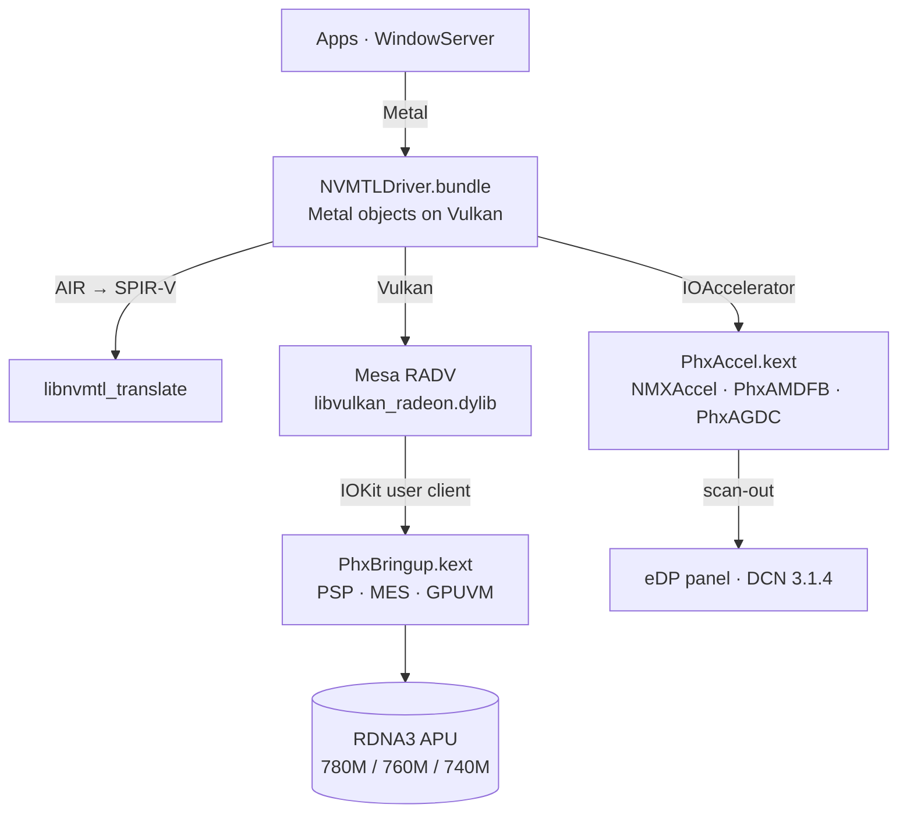

<p align="center">
  <picture>
    <source media="(prefers-color-scheme: dark)" srcset="assets/brand/nullarc-logo-dark.svg">
    
  </picture>
</p>

<p align="center">
  <b>Metal on AMD Radeon 780M, 760M & 740M for macOS Tahoe.</b><br>
  GPU bring-up, display compositor driver for WindowServer at 120 Hz, and Metal over Vulkan (Mesa RADV)<br>
  for Phoenix / Hawk Point APUs (RDNA 3, GC 11.0.1, gfx1103).
</p>

<p align="center">
  
  
  
  <a href="https://github.com/luuumi-dev/nullarc/releases"></a>
  <a href="https://github.com/luuumi-dev/nullarc/actions/workflows/ci.yml"></a>
  <a href="LICENSE"></a>
</p>

<p align="center"><b>English</b> · <a href="README_RU.md">Русский</a></p>

---

## This fork

**Fork of [luuumi-dev/nullarc](https://github.com/luuumi-dev/nullarc)**, ported to a machine the upstream project never ran on:
Lenovo IdeaPad Slim 5 16AHP10 (83HW), Ryzen 5 8645HS, **Radeon 760M** (Phoenix, PCI 1002:1900 rev C6, 8 CU), internal 2880×1800
OLED panel (EDID `LEN8BAD`), macOS Tahoe 26.7.1 (25G241), booted with OpenCore. Everything below the upstream commit `cbb08dd`
(2026-10-21) is this fork's work. The upstream README, architecture and licences are unchanged.

What is different from upstream:

| Area | Change | Status on 83HW |
|---|---|---|
| **GPU identity** | `PhxBringup` names the GPU from the CPU SKU (760M / 740M / 780M) instead of always "780M". | working |
| **Display on macOS 26.7** | `PhxFB` publishes a synthetic EDID, raises the connect interrupt so `IOFramebuffer` probes the panel, answers `kConnectionSupportsHLDDCSense` with a NULL value and any mode id, so WindowServer gets a real display instead of display id 0; `PhxAGDC` answers the 26.7 commands (`0x925`, `0x941`, `0x2001`, …). | working: WindowServer composites on the GPU |
| **Permissions** | `install.sh` makes the Metal plugin readable by WindowServer (`chmod -R go-w,a+rX` on `PhxGPU`). Re-running the installer used to reset it to root-only and acceleration silently disappeared. | working |
| **Logging** | `PhxFB` / `PhxAGDC` are quiet by default; `nvram phxfb-x=2` turns the per-call trace back on (`phxdebug=1` only gates PhxBringup's debug selectors). | working |
| **Refresh rate (experimental)** | `PhxFB` dumps OTG0's timing registers at start. On this panel the firmware lights 60 Hz by stretching the vertical front porch at the 120 Hz line rate (3080 × 3840, ~710 MHz; EDID range 30–120 Hz). Done at every start (opt out with boot-arg `-phxfb60` or `sudo nvram phxfb-60=1`): halves `V_TOTAL` to 1920 when the blanking registers agree, and keeps it only if the frame counter then shows ~120 Hz. | **works on 83HW**: frame counter 119.6 Hz after the switch (macOS then renders at 120 Hz); smoothness still being checked |
| **Brightness (experimental)** | `PhxFB` probes the eDP panel's backlight at start (`phxbl.h`): DPCD brightness over the AUX channel (eDP 1.4, the usual OLED way) or the display engine's PWM, whichever the panel is already using, and attaches an `IODisplayParameterHandler` so the display gets a `brightness` parameter. The probe and every set are logged (`PhxFB: BL:`). | **untested** |
| **HiDPI modes (experimental)** | The one display mode now carries the native / built-in / valid-for-HiRes / accelerator-backed flags CoreDisplay wants before it offers scaled ("looks like") modes. `nvram phxfb-x=4` restores the old flags, `phxfb-x=8` skips the backlight handler. | **untested** |
| **Display sleep (experimental)** | The framebuffer ignored display sleep: `pmset displaysleepnow` left the panel lit and the power draw unchanged (34.9 W awake, 34.9 W "asleep" on the 83HW). On power-off `PhxFB` now writes backlight duty 0 and restores the remembered level on wake. `nvram phxfb-x=16` turns this off. | **untested** |
| **OLED brightness (experimental)** | The 83HW's panel is an OLED: no PWM pin, so the PWM registers read alive (`BL_PWM_CNTL c000fa00`) but change nothing, and the slider did nothing. Linux dims it over AUX (AMD source-backlight DPCD: level in millinits at `0x320`, control `0x32E`, enable `0x32F`; sink bit `0x317[4]`). `PhxFB` now does the same when the sink reports an OLED, with display sleep switching `0x32F`. `nvram phxfb-x=32` falls back to the old PWM path. | **untested** |
| **CPU power (experimental)** | New `PhxPower.kext` ([`src/phxpower`](src/phxpower), an OpenCore `EFI/OC/Kexts` kext for AMD Family 19h model 70h-7Fh). With `DummyPowerManagement` macOS has no CPU power management: cores idle with a bare `HLT` and nothing writes AMD's CPPC request, so the 83HW idles at ~43 W under macOS against 5-8 W under Linux. Level 1 (default) writes the CPPC request on every CPU (energy-performance preference 191, as Linux's `amd-pstate-epp`); level 2/3 (`nvram phxpow=3` or boot-arg `phxpow=3`) also register a minimal `pmDispatch` so XNU's idle loop uses the ACPI I/O-port C2/C3 states (`CStateBaseAddr`+1/+2, the ports Linux's cpuidle uses). A boot that never reaches 20 minutes of uptime at level >= 2 makes the next boot fall back to level 1. | **untested** |
| **Build** | `.github/workflows/build-kexts.yml` builds `PhxAccel.kext`, `PhxBringup.kext` and `PhxPower.kext` on a macOS runner and uploads them (`kexts` artifact). | working |
| **Bluetooth (extra)** | [`extras/mtkbt`](extras/mtkbt) (MediaTek MT7925 USB Bluetooth, from [watchthelight-labs](https://labs.watchthelight.org/mt7925-hackintosh-bluetooth/)) and [`extras/legionbtfix`](extras/legionbtfix) with `.github/workflows/build-bt.yml`. Not part of the GPU driver. | MtkBt hung before the USB fix below; being retried |

Not done yet on this fork: external displays (HDMI, USB-C), hardware video decode.

Notes from the same machine that are not in this repo but matter for a working Hackintosh with it: `XHCILagFix`
([hbyonly1](https://github.com/hbyonly1/xhcilagfix), Lilu plugin) fixes the very slow USB-A/USB-C ports on AMD xHCI,
and an `SSDT` that sets `\_SB.PCI0.LPC0.EC0.ECAV` to 1 brings back the battery and AC state.

## Status

Measured on the reference machine — Firebat U6C, AMD Ryzen 7 7840HS / H 255, Radeon 780M (12 CUs), 2560×1600 120 Hz eDP, macOS Tahoe 26.6.2 (November 2026):

| Feature | State | Notes |
|---|---|---|
| **Desktop Compositing** | Working | WindowServer composites on GPU at 120 Hz; dragging windows and CoreAnimation stay pinned at 116–120 fps. |
| **Metal 3D Graphics** | Working | SceneKit 3D benchmarks achieve **117.2 FPS** at 2400×1500 (1.81 ms CPU/frame). Real rasterization validated via `mtlprobe render`. |
| **Metal Compute** | Working | Parallel compute verified (`mtlprobe`: 4096/4096 parallel workgroups return mathematically exact results). |
| **Performance Level** | Tier | Matches or exceeds Apple M2 (10-core GPU) / AMD Radeon Pro 5500M in raw compute; ~4–5× faster than Intel Iris Plus G7. |
| **Liquid Glass & Lensing** | Working | Dock, Control Center, widgets, and in-app glass drawn by GPU using Apple's compositor shaders (`glass_background_sdf_lpf` with SDF curvature). |
| **Display & Backlight** | Working | Native brightness slider in Control Center and Fn hotkeys work via dual PWM in `PhxAMDFB` (AppleBacklightDisplay). |
| **Audio** | Working | `AppleHDA` injected through `PhxHDA` (`alcid=18`) for built-in speakers and microphone. |
| **Night Shift** | Working | Color temperature adjustments apply smoothly via `kFramebufferSupportsGammaCorrection` and IORegistry gamma descriptors without CPU thrashing. |
| **Kernel Stability** | Working | Boot-time CPU spin in `doWaitSeq` replaced with adaptive backoff; no watchdog freezes or startup stalls. |
| **Sleep / Wake** | In Progress | Display sleep & wake fully functional; S4 Hibernation power management registered in IOKit (`PMinit` / `setPowerState`). |
| **Hardware Support** | Unified | Dynamic topology engine supports Radeon 780M (12 CUs), 760M (8 CUs), and 740M (4 CUs) via selector 30. |
| **Not yet** | WIP | External display PHYs (HDMI / Type-C DP via DCN 3.1.4 in progress), hardware VCN 4.0.2 video decode. |

Known bugs, architecture notes, and progress are tracked in [KNOWN_ISSUES.md](KNOWN_ISSUES.md) and [BUGS.md](BUGS.md).

## How it works



| Component | Installed in | Source | Role |
|---|---|---|---|
| `PhxBringup.kext` | OpenCore `EFI/OC/Kexts` | [`src/phxbringup`](src/phxbringup) | Loads firmware through PSP, initializes GFX (SMU/IMU), runs MES scheduler, manages per-process GPUVM address spaces, and implements selector 30 topology queries and fence wait queues. |
| `PhxAccel.kext` | Auxiliary kernel collection | [`src/phxaccel`](src/phxaccel) | `NMXAccel` IOAccelerator, `PhxAMDFB` framebuffer (VRAM pool, 120 Hz vblank, hardware gamma, dual PWM backlight) and `PhxAGDC` display timing. |
| `NVMTLDriver.bundle` | `/System/Library/.../PhxGPU`, linked from `/Library/GPUBundles` | [`src/nmplugin`](src/nmplugin) | Metal driver plugin: Metal over Vulkan, zero-copy IOSurfaces, shader disk caching, and MTLSimDriver texture buffer alignment. |
| `libvulkan_radeon.dylib` | `PhxGPU/nvmtl` | Mesa + [`mesa-patches-phoenix`](mesa-patches-phoenix) | RADV for gfx1103 with Darwin winsys and captured Phoenix/Hawk Point topology support (Patch 0007). |
| `phxboot` | LaunchDaemon `local.phxboot` | [`tools/phxctl/phxboot.sh`](tools/phxctl/phxboot.sh) | Initializes GPU at boot before WindowServer opens the panel, with automatic watchdog fail-safes. |

## Installing

Download the latest release package (`nullarc-v0.4.0-alpha.zip`) from the [Releases page](https://github.com/luuumi-dev/nullarc/releases) and follow **[docs/INSTALL.md](docs/INSTALL.md)**.

1. Add `PhxBringup.kext` and recommended boot-args (`phxdebug=1`, `amfi=0x80`, `amfi_get_out_of_my_way=0x1`) to OpenCore `config.plist`.
2. Copy `hardware/acpi/SSDT-ALIB.aml` to `EFI/OC/ACPI/` to prevent USB-C power event ACPI stalls.
3. Boot into macOS and run:
   ```sh
   sudo ./install.sh --windowserver
   ```
4. Reboot twice as prompted by the installer.

## Building and Testing

On the Mac (Command Line Tools, [MacKernelSDK](https://github.com/acidanthera/MacKernelSDK)):

```sh
sh src/phxbringup/build.sh /path/to/MacKernelSDK      # Builds PhxBringup.kext
sh src/phxaccel/build.sh /path/to/MacKernelSDK        # Builds PhxAccel.kext
cd src/nmplugin && ./build.sh                        # Builds NVMTLDriver.new
```

To run the complete host unit test suite:

```sh
make test
python3 tests/test_phx_profile.py
```

The test runner validates:
1. `test_rdna3_discovery_uma`: IP discovery & UMA ReBAR configuration
2. `test_rdna3_ip_dcn`: DCN 3.1.4 pixel timings and IP block bring-up
3. `test_rdna3_ucode`: GFX1103 ucode extractor with adversarial fuzzer
4. `test_r3n_abi`: UserClient ABI handshake, BO allocation, PM4 CS submission
5. `test_phx_topology`: 128-byte wire topology and CU/RB masks for 780M, 760M, and 740M
6. `test_wait_seq`: Non-spinning adaptive wait queues, timeout clamping, and fence retirement

## Notable Fixes

- **Eliminated Kernel Boot Spin**: Replaced CPU tight-spin `IODelay(100)` in `doWaitSeq` with adaptive scheduler sleep (`IOSleep(1)` for waits ≥ 1 ms), removing boot-time freezing.
- **Unified 780M / 760M / 740M Topology**: Added selector 30 `PHXN_SEL_TOPOLOGY` wire format in `PhxBringup` and Mesa patch 0007, dynamically adjusting ACO limits and CU active numbers.
- **iOS Simulator Fix (B-33)**: Added `-minimumTextureBufferAlignmentForPixelFormat:` in `NVMTLDevice.m`, stopping `MercuryPosterExtension` SIGFPE division-by-zero crashes.
- **Night Shift Smooth Transition (B-28)**: Enabled `kFramebufferSupportsGammaCorrection` and IORegistry gamma descriptors in `phxfb`, offloading LUT calculations from CPU to GPU.
- **USB-C Hotplug Crash Fix (B-01)**: Created `SSDT-ALIB` to gracefully handle `\_SB.ALIB(0x0C)` power events without ACPICA stack corruption.
- **Zero-copy IOSurfaces**: Direct mapping into GPU page tables drops WindowServer CPU load from 77% to under 6%.

## License and Credits

- Code written for nullarc (`src/phxbringup`, `tools/phxctl`, `tests/`): MIT / GPL-2.0-only.
- `src/phxaccel`, `src/nmplugin`: Derived from NullMoth's driver, **PolyForm Noncommercial 1.0.0** — noncommercial use only.
- `mesa-patches-phoenix`: MIT, as Mesa.

Special thanks to the Linux `amdgpu` kernel team, Mesa RADV contributors, NullMoth, [Cobalt64](https://cobalt64.com), [Acidanthera](https://github.com/acidanthera), Kreytus and DogoSoCool5.
