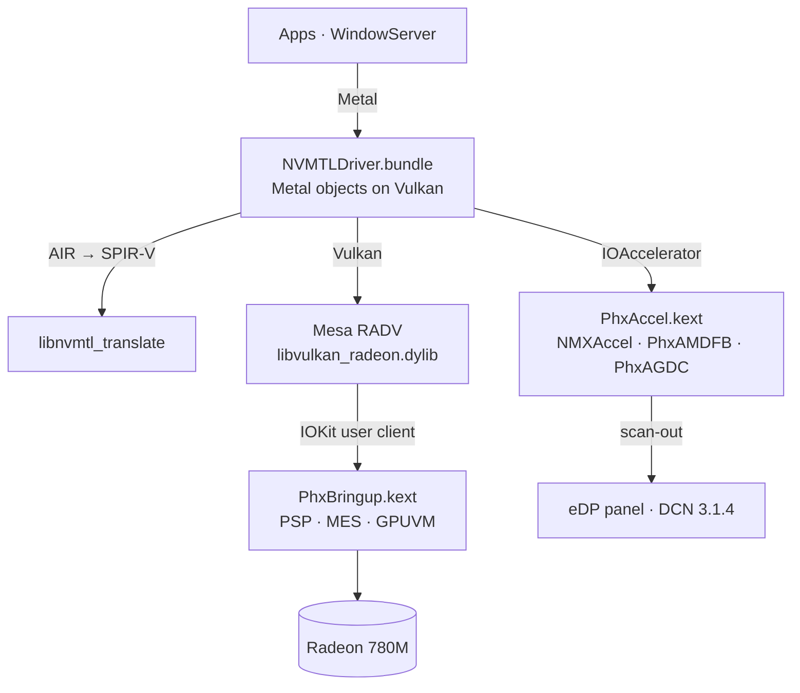

<p align="center">
  <b>Metal on AMD Radeon 760M for macOS Tahoe.</b><br>
  GPU bring-up, a display driver WindowServer composites on, and Metal over Vulkan (Mesa RADV)<br>
  for Phoenix / Hawk Point APUs (RDNA 3, GC 11.0.1, gfx1103).
</p>

<p align="center">
  
  
  
  <a href="https://github.com/luuumi-dev/nullarc/actions/workflows/ci.yml"></a>
  <a href="LICENSE"></a>
</p>

<p align="center"><b>English</b> · <a href="README_RU.md">Русский</a></p>

---

## This fork

**Fork of [luuumi-dev/nullarc](https://github.com/luuumi-dev/nullarc)**, ported to a machine the upstream project never ran on:
Lenovo IdeaPad Slim 5 16AHP10 (83HW), Ryzen 5 8645HS, **Radeon 760M** (Phoenix, PCI 1002:1900 rev C6, 8 CU), internal 2880×1800
OLED panel (EDID `LEN8BAD`), macOS Tahoe 26.7.1 (25G241), booted with OpenCore. Everything below the upstream commit `cbb08dd`
(2026-10-21) is this fork's work. The upstream README, architecture and licences are unchanged.

What is different from upstream:

| Area | Change | Status on 83HW |
|---|---|---|
| **GPU identity** | `PhxBringup` names the GPU from the CPU SKU (760M / 740M / 780M) instead of always "780M". | working |
| **Display on macOS 26.7** | `PhxFB` publishes a synthetic EDID, raises the connect interrupt so `IOFramebuffer` probes the panel, answers `kConnectionSupportsHLDDCSense` with a NULL value and any mode id, so WindowServer gets a real display instead of display id 0; `PhxAGDC` answers the 26.7 commands (`0x925`, `0x941`, `0x2001`, …). | working: WindowServer composites on the GPU |
| **Permissions** | `install.sh` makes the Metal plugin readable by WindowServer (`chmod -R go-w,a+rX` on `PhxGPU`). Re-running the installer used to reset it to root-only and acceleration silently disappeared. | working |
| **Logging** | `PhxFB` / `PhxAGDC` are quiet by default; `nvram phxfb-x=2` turns the per-call trace back on (`phxdebug=1` only gates PhxBringup's debug selectors). | working |
| **Refresh rate (experimental)** | `PhxFB` dumps OTG0's timing registers at start. On this panel the firmware lights 60 Hz by stretching the vertical front porch at the 120 Hz line rate (3080 × 3840, ~710 MHz; EDID range 30–120 Hz). Done at every start (opt out with boot-arg `-phxfb60` or `sudo nvram phxfb-60=1`): halves `V_TOTAL` to 1920 when the blanking registers agree, and keeps it only if the frame counter then shows ~120 Hz. | **works on 83HW**: frame counter 119.6 Hz after the switch (macOS then renders at 120 Hz); smoothness still being checked |
| **Brightness (experimental)** | `PhxFB` probes the eDP panel's backlight at start (`phxbl.h`): DPCD brightness over the AUX channel (eDP 1.4, the usual OLED way) or the display engine's PWM, whichever the panel is already using, and attaches an `IODisplayParameterHandler` so the display gets a `brightness` parameter. The probe and every set are logged (`PhxFB: BL:`). | **untested** |
| **HiDPI modes (experimental)** | The one display mode now carries the native / built-in / valid-for-HiRes / accelerator-backed flags CoreDisplay wants before it offers scaled ("looks like") modes. `nvram phxfb-x=4` restores the old flags, `phxfb-x=8` skips the backlight handler. | **untested** |
| **Build** | `.github/workflows/build-kexts.yml` builds `PhxAccel.kext` and `PhxBringup.kext` on a macOS runner and uploads them (`kexts` artifact). | working |
| **Bluetooth (extra)** | [`extras/mtkbt`](extras/mtkbt) (MediaTek MT7925 USB Bluetooth, from [watchthelight-labs](https://labs.watchthelight.org/mt7925-hackintosh-bluetooth/)) and [`extras/legionbtfix`](extras/legionbtfix) with `.github/workflows/build-bt.yml`. Not part of the GPU driver. | MtkBt hung before the USB fix below; being retried |

Not done yet on this fork: external displays (HDMI, USB-C), hardware video decode.

Notes from the same machine that are not in this repo but matter for a working Hackintosh with it: `XHCILagFix`
([hbyonly1](https://github.com/hbyonly1/xhcilagfix), Lilu plugin) fixes the very slow USB-A/USB-C ports on AMD xHCI,
and an `SSDT` that sets `\_SB.PCI0.LPC0.EC0.ECAV` to 1 brings back the battery and AC state.

## Status

Measured on the reference machine — Firebat U6C, Ryzen 7 H 255, Radeon 780M, 2560×1600 120 Hz eDP, macOS Tahoe 26.6.2 —
in October 2026:

| | |
|---|---|
| **Desktop** | WindowServer composites on the 780M at the panel's 120 Hz. CoreAnimation runs at 119–120 fps; dragging a window, 116 fps. |
| **Liquid Glass** | Dock, widgets, Control Center and in-app glass are drawn by the GPU with Apple's own compositor shaders (translated). |
| **Metal in apps** | Every process gets the Metal device, sandboxed WebKit GPU processes included. About 46 apps checked with no crashes, Safari, Chess and Spotify among them. |
| **Display sleep / wake** | Works. |
| **First use of a new effect** | A one-time pause of about 1–3 s while its shader is translated and compiled. After that it comes from the disk cache. |
| **Not yet** | External displays (HDMI, USB-C), hardware video decode/encode, backlight control. |

Other Radeon 780M / 760M machines (Phoenix, Hawk Point) are untested.

## How it works



| Component | Installed in | Source | Role |
|---|---|---|---|
| `PhxBringup.kext` | OpenCore `EFI/OC/Kexts` | [`src/phxbringup`](src/phxbringup) | Loads firmware through the PSP, powers up GFX (SMU/IMU), starts the MES scheduler and the compute and graphics queues, gives every process its own GPUVM address space, implements the BO/submit ABI RADV uses. |
| `PhxAccel.kext` | Auxiliary kernel collection | [`src/phxaccel`](src/phxaccel) | `NMXAccel` IOAccelerator, the `PhxAMDFB` framebuffer (VRAM pool, 120 Hz vblank, frame copy to scan-out) and `PhxAGDC` display control. |
| `NVMTLDriver.bundle` | `/System/Library/CoreServices/CoreTypes.bundle/Contents/Library/PhxGPU`, linked from `/Library/GPUBundles` | [`src/nmplugin`](src/nmplugin) | The Metal driver plugin: Metal on Vulkan, zero-copy IOSurfaces, shader caches. |
| `libvulkan_radeon.dylib` | `PhxGPU/nvmtl` | Mesa + [`mesa-patches-phoenix`](mesa-patches-phoenix) | RADV for gfx1103 with a Darwin winsys. |
| `phxboot` | LaunchDaemon `local.phxboot` | [`tools/phxctl/phxboot.sh`](tools/phxctl/phxboot.sh) | Brings the GPU up at boot before WindowServer opens the panel, with fail-safes that fall back to the firmware framebuffer. |

`libnvmtl_translate.dylib` (Metal AIR → SPIR-V, LGPL-3.0, based on metal2vulkan) ships prebuilt with NullMoth's
plugin; its source is attached to every release. The `NVMTL` prefix is NullMoth's too: none of this is an NVIDIA driver.

## Installing

Download `nullarc-<version>.zip` from the [releases page](https://github.com/luuumi-dev/nullarc/releases) and follow
**[docs/INSTALL.md](docs/INSTALL.md)**. In short: add `PhxBringup.kext` and the boot-args to OpenCore, reboot, run
`sudo ./install.sh --windowserver` from the release folder, reboot twice.

> [!WARNING]
> WindowServer only loads an ad-hoc signed driver with AMFI relaxed (`amfi=0x80`, `amfi_get_out_of_my_way=0x1`).
> That turns library validation off system-wide and FairPlay playback (Apple TV+, Netflix in Safari) stops working.
> `uninstall.sh` and the guide's last section undo everything.

## Building

On the Mac (Command Line Tools, [MacKernelSDK](https://github.com/acidanthera/MacKernelSDK)):

```sh
sh src/phxbringup/build.sh /path/to/MacKernelSDK      # PhxBringup.kext
sh src/phxaccel/build.sh /path/to/MacKernelSDK        # PhxAccel.kext
```

The plugin builds from `src/nmplugin/NVMTLDevice.m`, which includes the rest of `src/nmplugin`. RADV: Mesa
`f5cb8ee0` + Cobalt64's Darwin patches + [`mesa-patches-phoenix`](mesa-patches-phoenix/README.txt).

Unit tests (firmware parsing, IP discovery) run on Linux or macOS and in CI:

```sh
make fixtures   # Phoenix firmware from linux-firmware
make test
```

## Notable fixes

- **Zero-copy IOSurfaces** — textures are linear images over the surface's own pages; WindowServer CPU 77 % → 36 %.
- **Surface keep cache** — CoreAnimation re-wraps the same IOSurfaces every frame; keeping their imports took a dragged window from 64–69 to 116 fps.
- **VRAM pool** — per-allocation contiguous memory fragmented after hours and display wake froze; one 512 MB pool now.
- **RADV mutable descriptor lists** — indexed by the sorted binding order instead of the original one; broke CoreImage blurs and Tahoe's layered icons.
- **Nested loop unrolling (Mesa 0006)** — a new compositor shader variant compiled ~2 s in RADV, one loop level per optimisation round; now ~1 s with identical code.

## The name

**null + arc**: the empty-set sign of a driver that did not exist, its ring opened into an arc.
See the [brand guide](assets/brand/README.md).

## License and credits

Several licenses apply; see [LICENSE](LICENSE), [THIRD_PARTY_NOTICES.md](THIRD_PARTY_NOTICES.md) and [LICENSES/](LICENSES).

- Code written for nullarc (`src/phxbringup`, `tools/phxctl`, …): MIT, or GPL-2.0-only at your option.
- `src/phxaccel`, `src/nmplugin`, `tools/nvmtl-patches`: derived from NullMoth's macOS driver, **PolyForm Noncommercial 1.0.0** — no commercial use.
- `mesa-patches-phoenix`: MIT, as Mesa. Release packages also carry LGPL-3.0 (shader translator), LLVM and AMD firmware; see the notices.

Built on the work of the Linux `amdgpu` team, Mesa, NullMoth, [Cobalt64](https://cobalt64.com),
[Acidanthera](https://github.com/acidanthera) and the AMD-OSX community.
